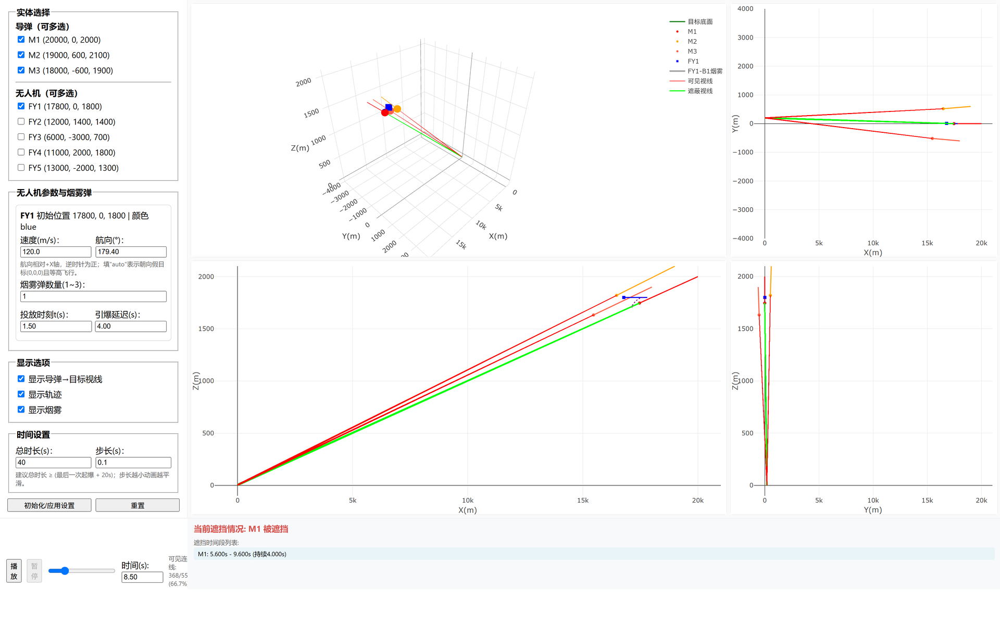

<div align="center">

# 烟幕干扰仿真 · 3D + 2D 交互可视化

**2025 年全国大学生数学建模竞赛 A 题「烟幕干扰弹的投放策略」**

[](https://www.mcm.edu.cn/)
[](https://plotly.com/javascript/)
[](#快速开始)
[](LICENSE)

[在线体验](https://alicefw1.github.io/cumcm-2025-smoke-interference-sim/) ·
[快速开始](#快速开始) ·
[判定逻辑](#仿真与遮挡判定逻辑) ·
[常见问题](#常见问题)

</div>



> 纯前端单页应用，无需安装、无需后端。Plotly 已内置，断网也能直接打开。

## 项目简介

这是一个面向 **2025 年 CUMCM A 题** 的交互式仿真可视化页面：在浏览器里调整导弹、无人机与烟雾弹参数，实时观察三维场景、三视图投影，以及导弹→假目标视线被烟幕遮挡的全过程。

页面把题目中的几何关系、运动学和遮挡判定做成了「所见即所得」的动画，适合用来：

- 快速验证投放策略的直觉，观察烟幕何时、何地进入视线；
- 给论文配图、答辩演示提供可交互的补充材料；
- 学习 Plotly 三维轨迹、多子图联动与几何判定在前端中的实现方式。

界面中的所有参数都可以现场修改，改完点击「初始化/应用设置」即可重算。

## 功能特性

| 能力 | 说明 |
| --- | --- |
| 多实体组合 | 3 枚导弹（M1–M3）、5 架无人机（FY1–FY5）任意勾选 |
| 单机参数 | 每架无人机独立设置速度（70–140 m/s）、航向、烟雾弹数量（1–3 枚） |
| 投放控制 | 逐枚设置投放时刻与引爆延迟，自动计算起爆点与起爆时刻 |
| 3D 场景 | 目标圆柱、导弹/无人机/炸弹轨迹、烟球线框、视线一屏展示 |
| 三视图 | XY / XZ / YZ 三个正交投影，便于读数和论文截图 |
| 遮挡判定 | 逐时刻计算视线是否被烟球遮挡，红色=可见、绿色=被遮挡 |
| 时段汇总 | 自动预计算并列出每枚导弹的遮挡时间段与持续时长 |
| 时间控制 | 播放 / 暂停 / 拖动时间轴 / 输入精确时刻 |
| 完全离线 | Plotly 本地化，不依赖 CDN；克隆后双击即可运行 |

## 快速开始

### 方式一：直接打开（推荐）

```bash
git clone https://github.com/alicefw1/cumcm-2025-smoke-interference-sim.git
cd cumcm-2025-smoke-interference-sim
```

双击 `index.html`，或用浏览器打开即可。页面不发起任何网络请求。

### 方式二：本地静态服务器

```bash
python -m http.server 8000
# 浏览器访问 http://localhost:8000
```

### 使用步骤

1. 在左侧勾选参与仿真的导弹与无人机；
2. 为每架无人机填写速度、航向、烟雾弹数量、投放时刻和引爆延迟；
3. 点击 **初始化/应用设置**；
4. 点击 **播放**，或拖动底部时间轴 / 输入时间，查看任意时刻；
5. 底部会显示当前是否被遮挡，以及所有遮挡时间段。

> 航向以 **+X 轴** 为 0°，逆时针为正；填写 `auto` 表示朝假目标 `(0,0,0)` 等高飞行。

## 仿真与遮挡判定逻辑

### 坐标系与运动

- 采用右手直角坐标系，X/Y 为水平面，Z 向上，单位均为米；
- 导弹以 **300 m/s** 沿直线飞向坐标原点（假目标）；
- 无人机在固定高度匀速平飞，速度范围 **70–140 m/s**；
- 烟雾弹脱离后做平抛运动（初速度继承无人机水平速度），重力加速度取 `g = 9.8 m/s²`。

炸弹在 `t_drop` 投放、经 `τ` 秒引爆，其起爆点可写为：

```math
\mathbf{p}_{e} = \mathbf{p}_{u}(t_{drop}) + \mathbf{v}_{u}\,\tau
                - \tfrac{1}{2} g \tau^{2}\,\hat{\mathbf{z}}
```

起爆后形成半径 **10 m** 的烟球，烟球中心以 **3 m/s** 匀速下沉，有效持续时间 **20 s**。

### 视线采样

目标简化为位于 `(0, 200, 5)`、半径 7 m、高 10 m 的圆柱。对每枚导弹，程序构造 **184 条** 采样视线：

- 目标上、下底面圆周各 72 个采样点（共 144 条）；
- 从导弹视角看目标的两条侧影母线，各 20 个采样点（共 40 条）。

对每条视线，计算烟球中心到线段（导弹位置 → 目标采样点）的最短距离 `d`。若 `d ≤ 10 m`，认为该方向被遮挡；当 **184 条全部被遮挡** 时，判定该时刻目标被完全遮蔽。

```math
d(\mathbf{s},\ \overline{\mathbf{m}\mathbf{q}})
= \left\| \mathbf{s} - \operatorname{proj}_{\overline{\mathbf{m}\mathbf{q}}}(\mathbf{s}) \right\|
```

页面按设定的步长 `dt`（默认 0.1 s）预计算整段仿真，把连续被完全遮蔽的采样点合并为「遮挡时间段」。

### 题目参数速查

| 参数 | 取值 |
| --- | --- |
| 假目标 | 圆心 `(0, 200, 5)`，半径 7 m，高 10 m |
| 导弹速度 | 300 m/s |
| 无人机速度 | 70–140 m/s |
| 烟球半径 | 10 m |
| 烟球下沉速度 | 3 m/s |
| 烟球有效时长 | 20 s |
| 重力加速度 | 9.8 m/s² |
| 导弹初始位置 | M1 `(20000, 0, 2000)`、M2 `(19000, 600, 2100)`、M3 `(18000, -600, 1900)` |
| 无人机初始位置 | FY1 `(17800, 0, 1800)`、FY2 `(12000, 1400, 1400)`、FY3 `(6000, -3000, 700)`、FY4 `(11000, 2000, 1800)`、FY5 `(13000, -2000, 1300)` |

## 目录结构

```text
cumcm-2025-smoke-interference-sim/
├── index.html                  # 单页应用（HTML + CSS + 原生 JS）
├── assets/
│   ├── plotly-2.30.0.min.js    # 本地化的 Plotly.js
│   └── plotly-LICENSE.txt      # Plotly MIT 许可证
├── docs/
│   └── preview.png             # README 界面截图
├── LICENSE                     # 本项目 MIT 许可证
├── .nojekyll                   # GitHub Pages 跳过 Jekyll
└── README.md
```

## 部署到 GitHub Pages

1. 打开仓库 **Settings → Pages**；
2. **Source** 选择 `Deploy from a branch`；
3. 分支选 `main`，目录选 `/ (root)`，保存；
4. 等待 1–2 分钟，访问 `https://<用户名>.github.io/cumcm-2025-smoke-interference-sim/`。

由于所有资源均为相对路径，也可以把整个文件夹放到任意静态服务器、校内网站或对象存储中。

## 二次开发提示

- 初始位置、速度、烟球半径等常量集中在 `index.html` 顶部（`TARGET_CENTER`、`MISSILES`、`UAVS` 等），修改后全局生效；
- 采样密度由 `NUM_CIRCLE_POINTS`、`NUM_SIDE_POINTS` 控制，调大可提高判定精度，但会增加计算量；
- 遮挡时段在每次「初始化/应用设置」后按 `dt` 预计算；把步长调小会更精确，同时更耗时；
- 页面不依赖构建工具，改完保存刷新即可。

## 常见问题

**Q：为什么 3D 里的烟球看起来很小？**

烟球真实半径只有 10 m，而仿真跨度约 21 km，二者相差三个数量级。可以拖动 3D 图缩放、旋转观察，或结合 XZ/YZ 投影与底部遮挡列表判断。

**Q：打开后图表空白怎么办？**

请确认 `assets/plotly-2.30.0.min.js` 与 `index.html` 的相对位置没有改变；不要只单独拷贝 `index.html`。

**Q：为什么默认参数下没有遮挡？**

默认只勾选 M1 与 FY1，且投放/引爆参数并非最优。可以调整投放时刻、引爆延迟与航向，让烟球在导弹视线附近起爆；截图中的示例就是一组合成的遮挡构型。

**Q：能直接用于竞赛提交吗？**

本页面是理解题意和展示结果的辅助工具，不包含求解器，也不构成任何题目的标准答案。竞赛论文请以完整建模与求解为准。

## 范围说明

本仓库**只包含数据可视化网页及其运行依赖**，不包含：

- 竞赛论文、PDF 题面或 LaTeX 源文件；
- 优化/求解脚本、结果 CSV、Excel 附件；
- 作者姓名、学校、队号、邮箱等个人信息。

## 免责声明

2025 年 CUMCM A 题题目及原始数据版权归全国大学生数学建模竞赛组织委员会所有。本项目为个人学习与技术交流用途的独立实现，与竞赛组委会无隶属或授权关系；页面中的判定采用几何近似，仅供学习参考。

## License

本项目代码采用 [MIT License](LICENSE)。内置的 Plotly.js 遵循其自身的 [MIT License](assets/plotly-LICENSE.txt)。

## 致谢

- [Plotly.js](https://plotly.com/javascript/) —— 三维轨迹与交互图表；
- 2025 年 CUMCM A 题提供的优秀建模背景。

如果这个页面对你的备赛或学习有帮助，欢迎点一个 **Star** ⭐，也欢迎提交 Issue / PR 一起完善。
